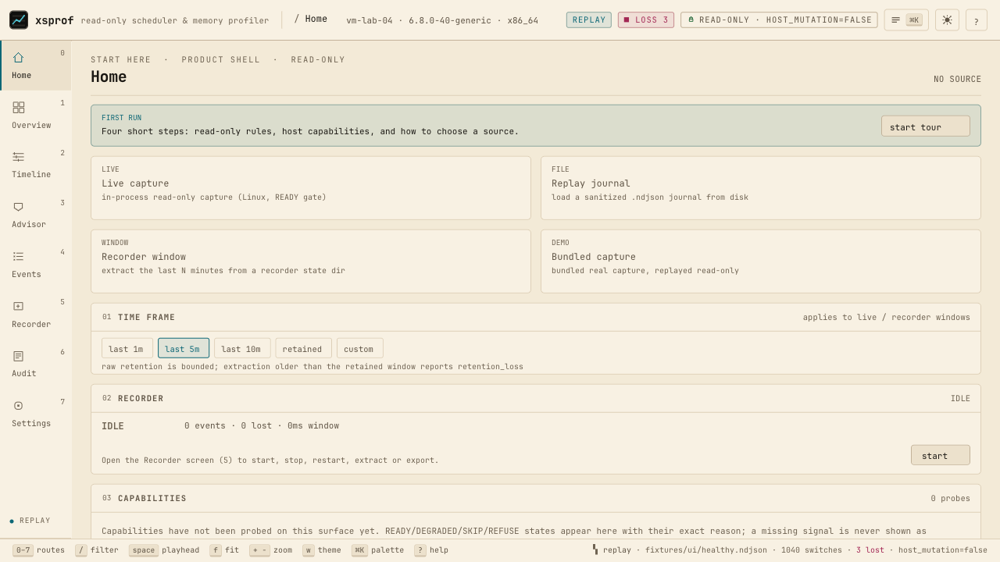
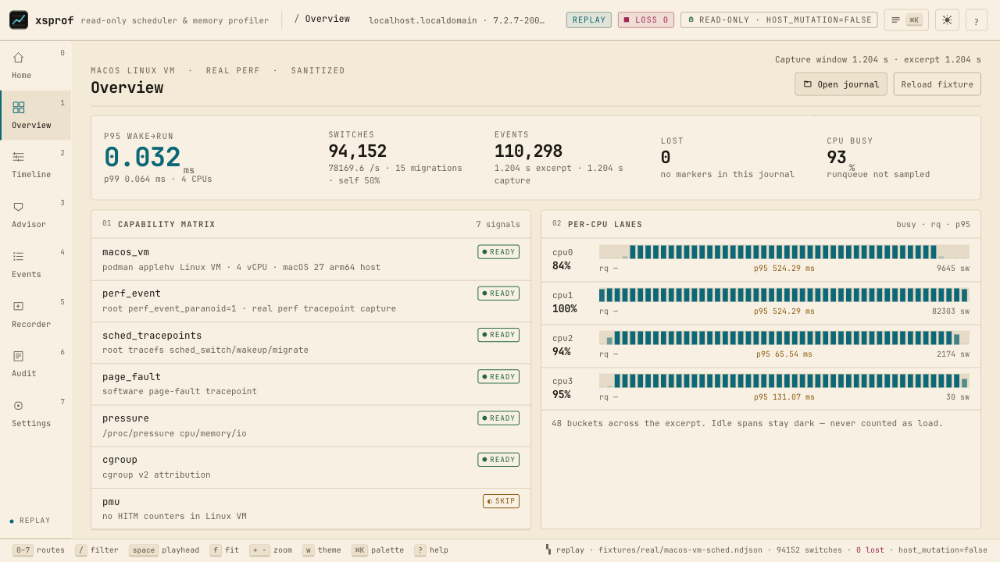
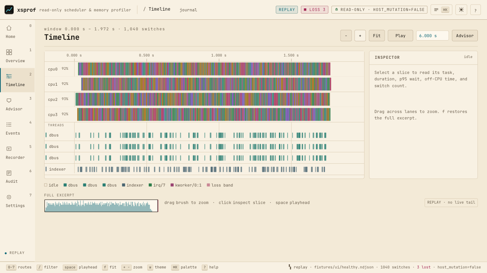
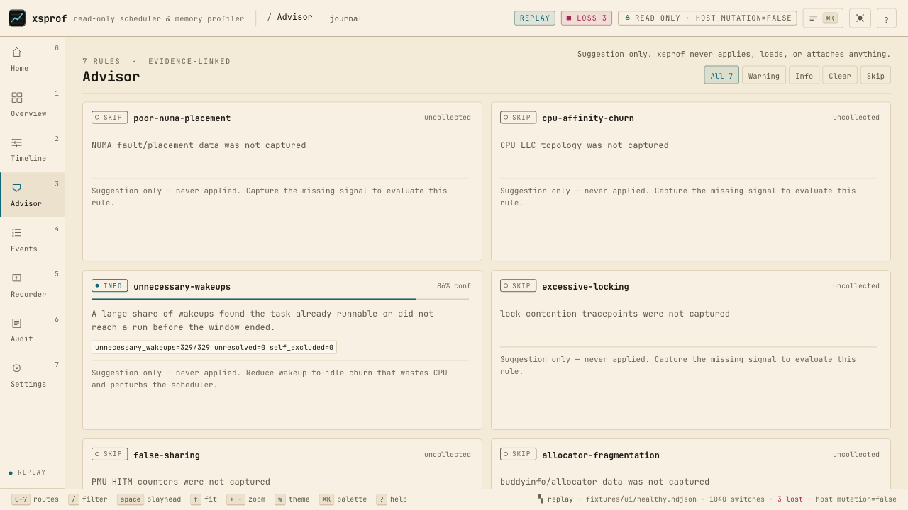
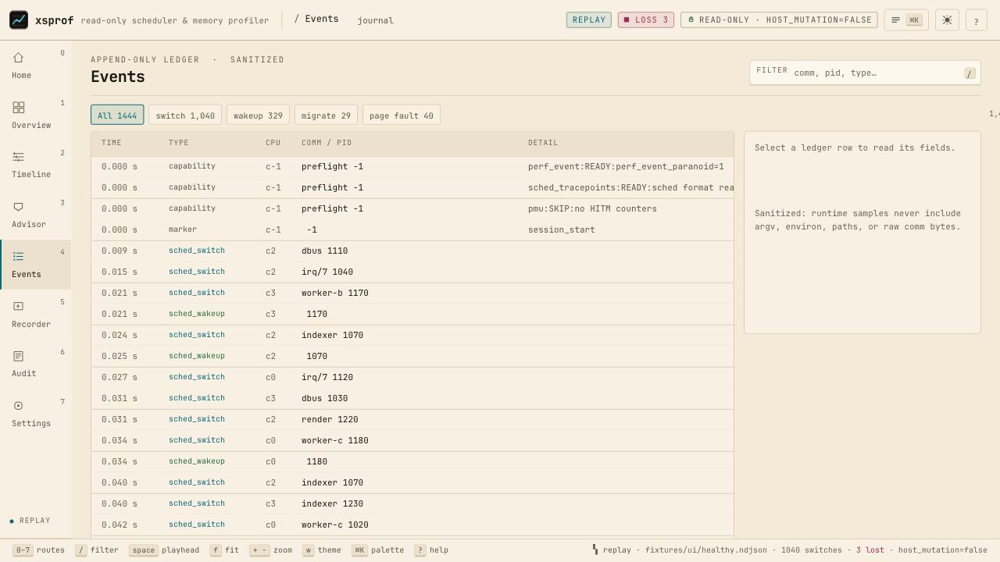
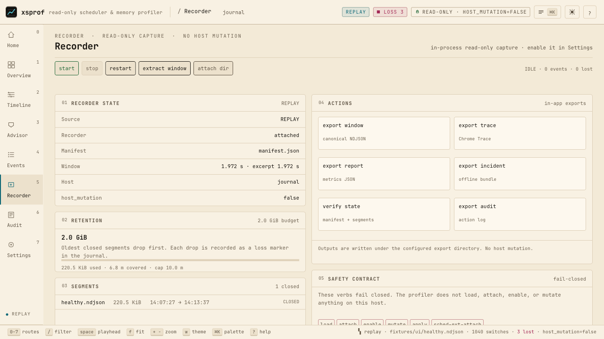
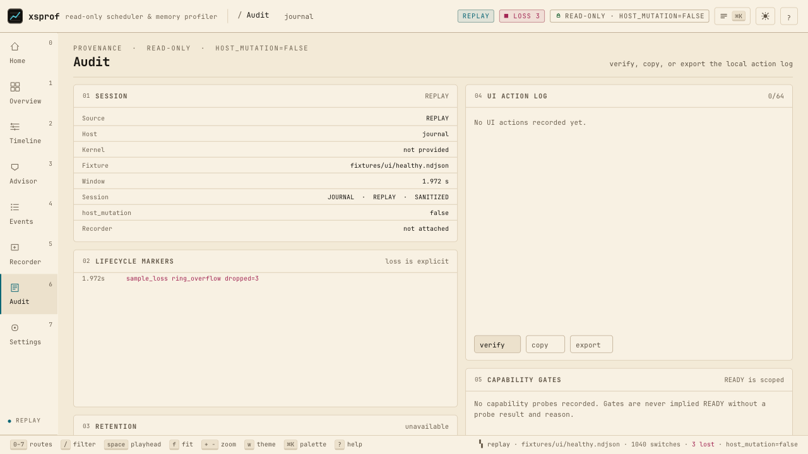
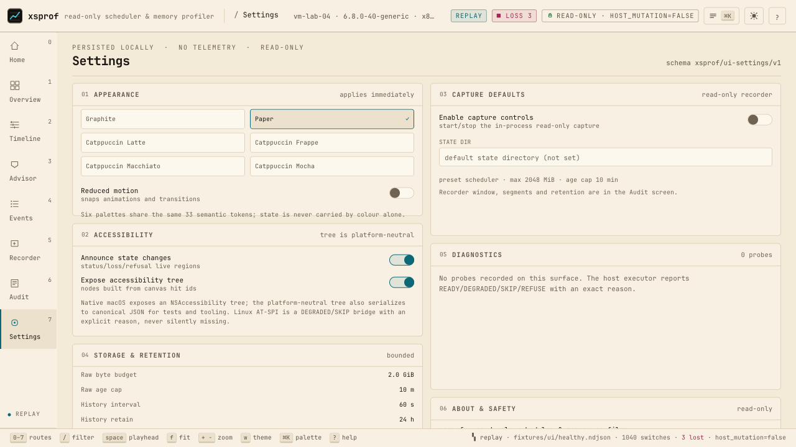
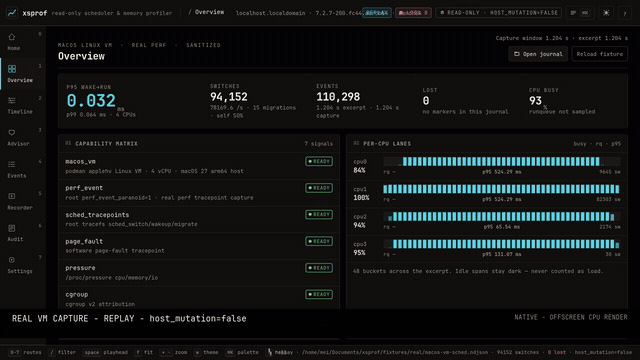

<p align="center">
  <picture><source media="(prefers-color-scheme: dark)" srcset="assets/logo.svg"></picture>
</p>

<h1 align="center">xsprof</h1>

<p align="center">
  A read-only Linux scheduler &amp; memory profiler with a native GPU operator console.
</p>

<p align="center">
  <a href="https://github.com/meillaya/xsprof/actions/workflows/zig-ci.yml"></a>
  <a href="https://github.com/meillaya/xsprof/actions/workflows/nix.yml"></a>
  <a href="https://github.com/meillaya/xsprof/releases"></a>
  <a href="LICENSE"></a>
  
</p>

---

## 🖼️ Screenshots

Native GPU console, rendered offscreen by the CPU rasterizer from committed fixtures; every still follows your system theme.

<div align="center">
  <picture><source media="(prefers-color-scheme: dark)" srcset="design/screenshots/native/dark/home.png"></picture>

  <br>

  <picture><source media="(prefers-color-scheme: dark)" srcset="design/screenshots/native/dark/overview.png"></picture>
  <picture><source media="(prefers-color-scheme: dark)" srcset="design/screenshots/native/dark/timeline.png"></picture>
  <picture><source media="(prefers-color-scheme: dark)" srcset="design/screenshots/native/dark/advisor.png"></picture>
  <picture><source media="(prefers-color-scheme: dark)" srcset="design/screenshots/native/dark/events.png"></picture>
  <picture><source media="(prefers-color-scheme: dark)" srcset="design/screenshots/native/dark/recorder.png"></picture>
  <picture><source media="(prefers-color-scheme: dark)" srcset="design/screenshots/native/dark/audit.png"></picture>
  <picture><source media="(prefers-color-scheme: dark)" srcset="design/screenshots/native/dark/settings.png"></picture>
</div>

The full light/dark still set also lives under
[`design/screenshots/native/`](design/screenshots/native/), regenerated by
`sh tools/screenshots.sh` (`--check` verifies committed bytes). All evidence is
offscreen CPU snapshots, never window capture ([method](design/evidence/README.md)).
The Overview stills render the committed real VM capture; its long session
identity is ellipsized in the topbar so the status chips stay readable.

### Live replay

The console tailing a real podman Linux-VM capture, labelled `REPLAY` with `host_mutation=false`:

<p align="center">
  <a href="design/media/xsprof-native-live-replay.mp4"></a>
</p>

[Showcase GIF](design/media/xsprof-native-showcase.gif) · [Showcase MP4](design/media/xsprof-native-showcase.mp4) · [Live replay GIF](design/media/xsprof-native-live-replay.gif) · [Live replay MP4](design/media/xsprof-native-live-replay.mp4)

---

## ✨ What it is

`xsprof` samples Linux scheduler and memory events read-only, then hands the
evidence to one native GPU console. There is no browser, WASM, or server
surface: the console is the product and the CLI is the automation lane.

- [x] **Eight routes** — Home, Overview, Timeline, Advisor, Events, Recorder, Audit, Settings.
- [x] **Native GPU console** — one flat draw list rendered by CPU, Metal, or OpenGL 3.3 via [`lib/xsui`](lib/xsui/README.md).
- [x] **Read-only recorder** — in-process Linux perf capture, capability-gated with READY/DEGRADED/SKIP/REFUSE and a reason.
- [x] **Compact `.xsraw` tier** — 64-byte header, CRC-32C 32 KiB blocks, block-local string tables, ten-minute age cap.
- [x] **Exports** — capture window, incident bundle (`window.ndjson`, `summary.json`, `report.html`, `trace.json`), Chrome Trace, sidecar history.
- [x] **Accessibility tree** — `xsprof/a11y-tree/v1` from the same draw/hit pass; macOS NSAccessibility, Linux JSON with honest AT-SPI2 DEGRADED.
- [x] **Six palettes** — Graphite, Paper, and Catppuccin Latte/Frappe/Macchiato/Mocha, light and dark.
- [x] **Automation CLI** — canonical `xsprof/*` JSON; **no host mutation** — every serialized record carries `host_mutation=false`.

## 📦 Installation

### Nix (x86_64/aarch64 Linux, aarch64/x86_64 Darwin)

```sh
nix run github:meillaya/xsprof -- demo        # bundled capture in the console
nix profile install github:meillaya/xsprof    # install
nix build .#xsprof                            # from a checkout
```

### Release artifacts

```sh
chmod +x Xsprof-0.5.1-x86_64.AppImage && ./Xsprof-0.5.1-x86_64.AppImage ui   # AppImage, host X11/GL
sudo dpkg -i xsprof_0.5.1-1_amd64.deb                                        # Debian / Ubuntu
tar -xzf xsprof-0.5.1-linux-x86_64.tar.gz && ./xsprof-0.5.1-linux-x86_64/bin/xsprof ui  # tarball
# macOS: unzip Xsprof-0.5.1-macos.zip, then open Xsprof.app
brew tap meillaya/xsprof && brew install xsprof                              # Homebrew, Linux only
```

Strict releases publish checksummed Linux artifacts and a notarized macOS
bundle; local macOS builds without Apple credentials are ad-hoc signed as
`-unsigned` and are never cask-eligible. Notarization and tap publication are
credential-gated — see
[`packaging/README.md`](packaging/README.md) and [install guide](docs/guides/install.md).

### From source

```sh
git clone https://github.com/meillaya/xsprof && cd xsprof
./tools/zig build
./zig-out/bin/xsprof
```

Linux 5.10+ with runtime-loaded X11/GLX, macOS 15+ with the Xcode SDK; Zig 0.17.0 is pinned by `./tools/zig`. No third-party runtime dependencies.

### First run

```sh
xsprof                    # native console on an interactive graphical TTY
xsprof demo               # bundled capture in the native console
XSPROF_NO_UI=1 xsprof     # quickstart only; never opens a window
```

`ui`/`demo` need a real desktop session; headless jobs use
`xsprof snapshot --replay <fixture> --out FILE` and JSON verbs instead.

## 🚀 Deployment options

Four lanes, one read-only contract; none of them changes scheduler or memory
policy.

| Lane | Who it is for | What runs | Safety boundary |
|---|---|---|---|
| **Native console** | Workstation operator | `xsprof` / `xsprof demo`; Live, recorder window, replay, demo sources | Observes the host read-only; may own its read-only recorder; writes settings/audit/state |
| **Headless automation** | Scripts, CI, remote SSH | explicit verb + `--json`; `XSPROF_NO_UI=1` forces it | Canonical `xsprof/*` JSON; no window, server, or network surface |
| **Recorder service** | Long-running host or VM | `xsprof daemon --foreground --dir DIR` via systemd/NixOS; attach with `xsprof ui --follow-recorder DIR` | Writes only its state directory; external recorders are attach-only |
| **Disposable VM** | Maintainers | `qa/vm_acceptance.sh` (KVM podman host); microVM lane | Root-only gates run inside a disposable Linux VM |

```sh
xsprof top --json                                               # headless metrics
sudo xsprof daemon --foreground --dir /var/lib/xsprof --retain 10m --max-bytes 2G
xsprof ui --follow-recorder /var/lib/xsprof                     # read-only attach
```

`daemon --foreground` is the only long-running process; Ctrl-C is a cooperative
stop. Live capture needs Linux perf tracepoints and `CAP_PERFMON`, which the
operator owns granting ([recording permissions](docs/guides/capture-permissions.md)).

The microVM lane is the lightweight complement: `nix run .#xsprof-microvm-tcg`
boots a disposable NixOS guest (TCG, no `/dev/kvm` needed) for headless packaged
checks — version, help, doctor, capabilities, snapshot determinism, the
accessibility tree, and the lab scenario runner. It does not claim privileged
live capture; root perf/live/service/retention gates stay with
`qa/vm_acceptance.sh` on a KVM host ([microVM guide](docs/guides/microvm.md),
[committed TCG evidence](docs/evidence/microvm/results-tcg.json)).

## ❄️ NixOS configuration

The recorder service is **disabled by default**; enabling it creates an
unprivileged `xsprof` user and grants only `CAP_PERFMON` and `CAP_DAC_READ_SEARCH`.

```nix
{
  inputs.xsprof.url = "github:meillaya/xsprof";
  outputs = { nixpkgs, xsprof, ... }: {
    nixosConfigurations.myhost = nixpkgs.lib.nixosSystem {
      system = "x86_64-linux";
      modules = [
        xsprof.nixosModules.default
        {
          services.xsprof.recorder.enable = true;
          hardware.graphics.enable = true; # hardware GL for `xsprof ui`
        }
      ];
    };
  };
}
```

| Option | Default | Meaning |
|---|---|---|
| `user` / `group` | `xsprof` | unprivileged recorder identity |
| `stateDir` | `/var/lib/xsprof` | state directory (must live under `/var/lib`) |
| `retain` / `maxBytes` | `10m` / `2G` | raw journal age cap and byte budget |
| `historyInterval` / `historyRetain` | `60s` / `24h` | sidecar cadence and horizon |
| `extraArgs` | `[]` | extra read-only daemon args; unsafe verbs fail evaluation |

Home Manager: `home.packages = [ inputs.xsprof.packages.${pkgs.system}.default ];`

`nix develop` provides the pinned toolchain; `nix build .#xsprof` builds and
`nix flake check` evaluates the module, package smoke, Zig pins, and version
sync without booting a VM. Intel macOS needs a second locked input because
nixpkgs 26.11 dropped `x86_64-darwin`; see [`nix/module.nix`](nix/module.nix).

---

## 🧩 Extensions & theming

- **UI toolkit** — [`lib/xsui`](lib/xsui/README.md) is a standalone GPU UI package
  (path dependency; CPU, Metal, GL 3.3): `ui.custom` painters, injectable fonts,
  `themes.derive` overrides, renderer backends, and a headless `Tester`.
- **Themes** — six selectable palettes (Graphite, Paper, Catppuccin Latte/
  Frappe/Macchiato/Mocha); `design/palettes.json` is the color source and
  `design/ui-spec.json` the contract. `lib/xsui` embedders can also use
  `xsui.themes.high_contrast` or derive tokens. Validate with
  `python3 design/validate.py` ([design/README.md](design/README.md)).
- **Wire schemas** — canonical `xsprof/*` JSON in
  [`schemas/xsprof/`](schemas/xsprof/README.md), fixtures in `fixtures/`, golden
  bytes in `tests/golden/`. Consume `event/v1`, `metrics/v1`, `lab-run/v1`, ...
- **Scenarios & lab** — [`scenarios/`](scenarios/healthy.json) run headlessly with
  `xsprof lab`; A/B CI gates use `xsprof compare --fail-on wait.p95=10%`
  ([guide](docs/guides/compare-ci.md)).
- **Services** — packaged
  [`systemd` unit](packaging/systemd/xsprof-recorder.service) and
  [`NixOS module`](nix/module.nix); `extraArgs` is checked against unsafe verbs.
- **Completions** — `xsprof completions bash|zsh|fish`, `--all` for automation.

## 🎛️ The console

Eight routes, one draw list. Route keys work everywhere; every pointer action has a keyboard equivalent and is exposed in the accessibility tree.

`0` Home · `1` Overview · `2` Timeline · `3` Advisor · `4` Events ·
`5` Recorder · `6` Audit · `7` Settings

`Cmd/Ctrl+K` palette · `?` help · `Esc` close · `/` filter · `Space` pause · `f` fit ·
`+`/`-` zoom · `t` now · `w` theme · `Cmd/Ctrl+,` Settings; dialogs trap focus.

Themes: `xsprof ui --theme dark|paper|latte|frappe|macchiato|mocha`, also
selectable in `Settings → Appearance`.

CLI: visible `ui`, `record`, `top`, `why`, `incident`, `doctor` (plus `demo`,
`version`, `help`); hidden but valid: `daemon`, `capture`, `history`, `watch`,
`verify`, `advise`, `metrics`, `compare`, `timeline`, `snapshot`, `preflight`,
`capabilities`, `pressure`, `cgroup`, `bpf-gate`, `lab`.

```sh
xsprof help --all
xsprof top --json
xsprof snapshot --view home --theme paper --out home.png
```

## 🛡️ Safety

Release-blocking invariants; full rules in
[`docs/safety/invariants.md`](docs/safety/invariants.md).

- **Read-only host** — never writes `/proc`, `/sys`, tracefs, cgroups,
  affinities, priorities, or scheduler policy; every serialized record carries
  `host_mutation=false`.
- **No privilege escalation** — probes return READY/DEGRADED/SKIP/REFUSE with a
  reason; they never elevate or suggest elevation.
- **No mutation verbs** — `load`, `attach`, `enable`, `mutate`, `apply`,
  `sched-ext-attach`, `setaffinity`, `setpriority`, and `bind` refuse non-zero
  before dispatch; BPF stays VM-marker-gated and host-refused.
- **No secrets** — no argv, environment, secrets, or tokens; `comm` is bounded
  and details are redacted.
- **No network** — no telemetry, external fonts, CDNs, or external requests.
- **Advisor is advice** — findings are printed or copied, never applied.

The native console may start and stop its own read-only recorder once the perf
probe is READY; external recorders are attach-only. State/export paths are its own.

## 🧪 Testing & verification

```sh
./tools/zig build check             # fmt, 600-line limit, vendor, tests, QA gates
./tools/zig build fuzz              # deterministic parser fuzz
./tools/zig build compact-roundtrip # .xsraw decode/verify/corruption gate
./tools/zig build a11y-smoke        # deterministic accessibility tree
./tools/zig build release-tooling   # attestation/tap dry-run, never publishes
./tools/zig build xsui-package      # standalone GPU UI package gate
./tools/zig build script-syntax     # offline shell syntax gate (also in check)
qa/vm_acceptance.sh                 # KVM podman host: live/service/retention
sh qa/microvm_verify.sh             # boot the packaged binary in a disposable microvm.nix guest
nix run .#xsprof-microvm-tcg        # run that microVM guest directly (TCG)
# GitHub Actions: run the manual "microvm" workflow to reproduce this in CI
```

Headless by default: native windows are human-run, so automated work uses CPU
snapshots, hidden-window/Xvfb smokes, and the gated live/service/retention gates
in a disposable Linux VM. Verify stills with `sh tools/screenshots.sh --check`;
evidence: [`docs/evidence/`](docs/evidence/v0.5.0-vm/README.md) (plus the
[TCG microVM run](docs/evidence/microvm/results-tcg.json)) and
[`design/evidence/`](design/evidence/README.md).

## ⚠️ Known limits

- Linux AT-SPI2 screen-reader bridging is not built; the canonical tree, focus
  order, and JSON dump are provided with a visible DEGRADED reason. macOS
  VoiceOver still needs a human-run audit.
- Native live capture needs Linux perf tracepoints and `CAP_PERFMON` (or
  `perf_event_paranoid <= 1`); macOS live capture is SKIP by design.
- The ten-minute raw tier is an age cap under a byte budget: the console and
  `verify` report the actual covered span, never the configured cap.
- Native rendering is 1x; Retina 2x crispness, X11 IME/paste parity, and
  real-window video capture by agents remain follow-ups.
- A/B compare and `lab` scenarios are headless tools, not console controls.
- Real Developer ID notarization, Gatekeeper acceptance, and Homebrew tap
  publication need external credentials; the repository ships fail-closed
  tooling and local dry-runs.

## 📚 Documentation

| Doc | Contents |
|---|---|
| [Quickstart](docs/guides/quickstart.md) | launch, demo, live/recorder, exports |
| [Recording permissions](docs/guides/capture-permissions.md) | setcap, privileged daemon, systemd |
| [Flight recorder](docs/guides/flight-recorder.md) | retention, extraction, incident bundles |
| [top & why](docs/guides/top-why.md) | live ranking and root-cause reports |
| [Event fields](docs/architecture/events.md) | `a`/`b`/`c` semantics per event kind |
| [Raw segment v1](docs/architecture/raw-segment-v1.md) | `.xsraw` layout, CRC, torn tails |
| [Retention](docs/architecture/retention.md) | measured windows, age cap vs byte budget |
| [MicroVM guide](docs/guides/microvm.md) | disposable NixOS verification lane |
| [v0.5.0 audit](docs/audit/v0.5.0.md) | native-only changes and VM evidence |
| [Design contract](DESIGN.md) · [tokens](design/README.md) · [xsui](lib/xsui/README.md) | UI contract, palettes, UI package |

More: [install](docs/guides/install.md) · [platforms](docs/platforms/linux.md) · [packaging](packaging/README.md) · [schemas](schemas/xsprof/README.md).

---

## 💛 Credits

- **Zig 0.17.0** — language and toolchain; `./tools/zig` pins and bootstraps it.
- **JetBrains Mono** — bundled under the SIL Open Font License 1.1.
- **Catppuccin** — Latte, Frappe, Macchiato, and Mocha palettes.
- **nanoui** — the Objective-C `msg` pattern adapted in `lib/xsui` (MIT).
- **microvm.nix** — the disposable NixOS verification lane.
- **podman + Fedora CoreOS** — the disposable KVM VM behind the live/service/
  retention evidence; `fixtures/real/macos-vm-sched.ndjson` comes from it and
  the console labels it REPLAY.

## 📄 License

MIT — see [LICENSE](LICENSE). Bundled third-party notices (nanoui, JetBrains
Mono) are in [THIRD_PARTY_NOTICES.md](THIRD_PARTY_NOTICES.md).

<p align="center"><sub>Read-only by design · host_mutation=false everywhere</sub></p>
