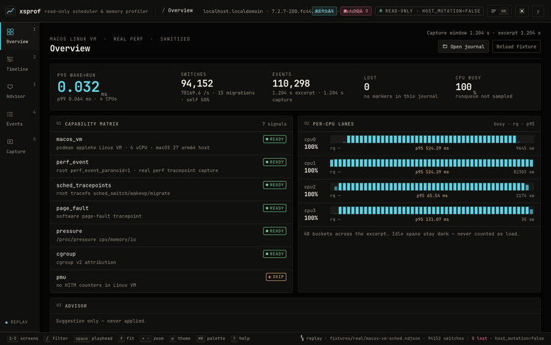
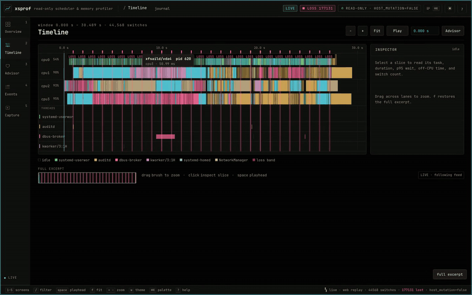

<p align="center">
  
</p>

<h1 align="center">xsprof</h1>

<p align="center">Read-only Linux scheduler and memory profiler.</p>

<p align="center">
  
</p>

<p align="center"><strong>Replay</strong> of a real 110,284-event Linux-VM perf capture ·
<a href="design/media/xsprof-ui-demo.mp4">full MP4</a></p>

<p align="center">
  
</p>

<p align="center"><strong>Live</strong> VM stream over the loopback tunnel ·
<a href="design/media/xsprof-ui-live.mp4">full MP4</a></p>

`xsprof` correlates scheduler and page-fault events without changing the host.
It records perf tracepoints into bounded rotating segments, extracts the recent
window after an incident, and writes a self-contained offline bundle (raw
window, canonical summary, static HTML report, Chrome Trace). It runs a
seven-rule advisor that reports `SKIP` when a rule's signal was not captured.
The recorder's own task is identified and excluded from rankings and
wakeup-churn analysis. Its operator console is the prototype from
[`design/index.html`](design/index.html): overview, timeline, advisor, events,
and capture status, fed by real replay/live data with no fabricated metrics.
The GPU surface is the standalone [`lib/xsui`](lib/xsui/README.md) package:
one draw list rendered by CPU, Metal, OpenGL 3.3, or WebGL2. The historical
lab bench remains available as a headless developer tool, not the main UI.

## Requirements

Zig 0.17.0 is pinned by `./tools/zig`. `devenv shell` provides git, curl, and
xz but keeps the pinned Zig on `tools/zig`. macOS 15+ and Linux 5.10+ are
supported.
The native macOS UI needs the Xcode SDK; the native Linux UI loads X11 and GLX
at runtime. The shipped binary has no third-party runtime dependencies.

## Build

```sh
./tools/zig build                # zig-out/bin/xsprof
./tools/zig build check          # formatting, line limit, vendor hashes, tests
./tools/zig build xsui-package   # standalone lib/xsui package gate
./tools/zig build web            # wasm UI and browser assets
./tools/zig build run -- help
```

## Use

```sh
xsprof record --duration 2000 --output session.ndjson
xsprof advise --input session.ndjson --json
xsprof advise --input session.ndjson --md
xsprof daemon --foreground --dir /var/lib/xsprof
xsprof incident --last 10m --dir /var/lib/xsprof --out incident/
xsprof history --last 10m --dir /var/lib/xsprof
xsprof capture --last 5m --dir /var/lib/xsprof
xsprof watch --dir /var/lib/xsprof
xsprof serve --journal session.ndjson
xsprof serve --journal session.ndjson --recorder-dir /var/lib/xsprof
xsprof serve --live                     # Linux live capture
xsprof ui --replay session.ndjson --recorder-dir /var/lib/xsprof
xsprof snapshot --replay session.ndjson --view timeline --theme mocha --backend cpu
xsprof demo
xsprof lab --scenario scenarios/healthy.json --out /tmp/lab --json
```

CPU is the canonical renderer; Metal, OpenGL, and WebGL2 consume the same draw
list and browser-generated text atlas, and the formal cross-surface gate checks
them against CPU. The HTML prototype is the design source, not a pixel oracle.
The web, native, and snapshot surfaces share one console model. The web console
is at `http://127.0.0.1:<port>/?token=…`; it reads `/api/journal`,
`/api/meta`, `/api/recorder`, and the live SSE stream. `?demo=1` loads the
extracted prototype fixture only for design comparison; production replay and
live sessions use the journal and recorder APIs. `snapshot --demo-model` is
the corresponding developer flag.

`record` needs perf tracepoints and `CAP_PERFMON`; without them it reports
`SKIP` and exits non-zero. `daemon` keeps one capture open, rotates segments,
and writes an atomic manifest. `watch` is the SSH view. `serve`
exposes a loopback replay or live view behind a random token. `ui` opens the
native profiler. Unknown verbs fail closed.

## Safety

Every record carries `host_mutation=false`. The profiler does not write
`/proc` or `/sys`, elevate privileges, enable BPF on a host, or auto-apply
advisor recommendations. `load`, `attach`, `enable`, `mutate`, `apply`,
`sched-ext-attach`, `setaffinity`, `setpriority`, and `bind` are refused.
Runtime samples never include argv, environment variables, secrets, or tokens.

## Package

```sh
./tools/package.sh              # Linux/macOS tarball
./tools/package_macos_app.sh    # universal macOS app, ad-hoc signed
```

## Development

```sh
./tools/zig build test
./tools/zig build fuzz
(cd lib/xsui && ../../tools/zig build test)   # package in isolation
./tools/zig build service-smoke               # Linux root, disposable VM
qa/retention_bench.sh 600000 0 2G yes         # Linux root, disposable VM
```
